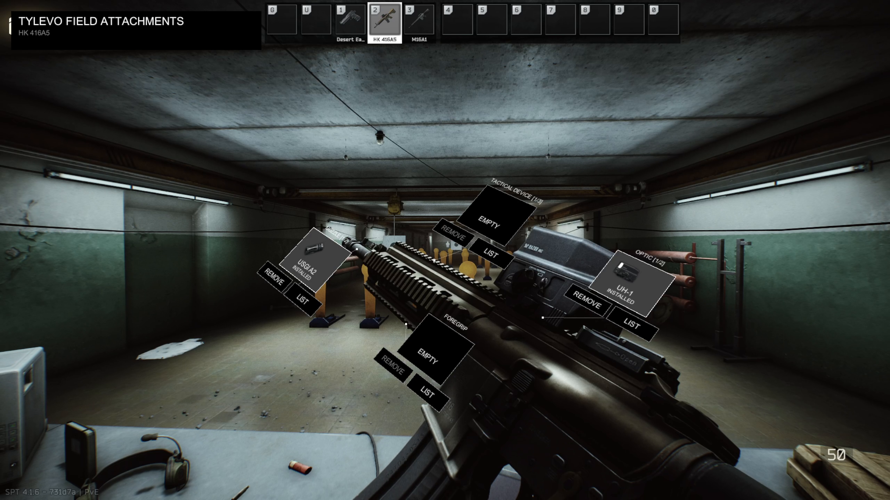
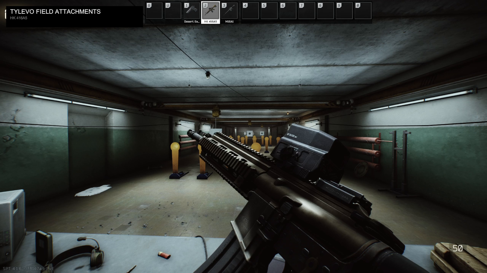

# Tylevo Field Attachments

Change attachments without opening your inventory. Hold **Left Alt** to bring up the cards around your weapon, click a thumbnail to see your carried parts, and use the wheel to browse. Carry a **Leatherman Multitool** to change stocks, handguards and pistol grips too.

**Version 1.2.0 · SPT 4.1.5 / 4.1.6**

[Stance comparison](#stance-transition-comparison) · [Installation](#installation) · [Controls](#controls) · [Compatibility](#compatibility-and-coverage) · [Source code](https://github.com/Tylevo/Tylevo.FieldAttachments)

*HK416 gameplay from an earlier version. The current cards open their lists from the thumbnail.*

View the HK416 inspection frame

## Stance transition comparison

With [Fontaine's Stance Overhaul](https://sp-mod.com/mod/3136/spt-stance-overhaul), your weapon moves from its current stance into the attachment view.

**Fully optional, but recommended. All Field Attachments features work without it.**

**Without Stance Overhaul**

The standard Field Attachments animation.

**With Stance Overhaul**

Four examples of moving from a stance into the attachment view.

## What it does

- Shows tilted cards for **optics, muzzle devices, tactical devices and foregrips** that follow your weapon.
- Installs into an empty slot, removes an installed part or replaces it with a carried alternative.
- Shows compatible parts you've examined and are carrying in accessible pockets, rig, backpack or secure container.
- Lets you cycle between mounting points, including different handguard positions. The slot count and connection line identify the selected point.
- Moves an assembled **optic and mount together**, keeping the sight attached.
- Holds your weapon at an angle so you can see its attachments. Normal weapon inspection still works separately.
- Shows how a part would change your ergonomics, recoil and weight before you fit it.
- Adds a **Multitool layer** for stocks, handguards and pistol grips when you're carrying a Leatherman Multitool.
- Explains why carried parts are unavailable at the selected mounting point.
- Supports optional Stance Overhaul transitions. Every feature also works without it.

**Attachment changes are enabled on a fresh install.** Turn off **F12 → General → Allow attachment changes** to browse without moving parts. Updates preserve your saved setting.

### Attachment comparison

Click a card's thumbnail to open its parts list, then hover a part to see how it would change your weapon's ergonomics, vertical recoil, horizontal recoil and weight. The full comparison sits at the top right; two smaller bars beside the list show ergonomics and vertical recoil. Green marks an improvement and red marks a loss.

You can also preview removing a part. Hovering only shows the comparison; nothing moves until you click. If a value can't be calculated reliably, the preview says it's unavailable.

### Why a part is unavailable

If a carried part is missing from the list, click **Unavailable** at the bottom. It explains problems such as a part that doesn't fit, an unexamined attachment, a missing required part or a missing Multitool. Unexamined items stay unnamed. These entries are for reference; click **Back to parts** to return to your choices.

### Multitool layer

Press **middle mouse** while the menu is open to switch between **Basic** and **Multitool**. You can also click the layer button beside the bottom controls. The Multitool layer has three cards: **Stock**, **Handguard** and **Pistol Grip**. They keep the same tilted view, with a short fade as you switch layers.

Carry a **Leatherman Multitool** in accessible storage or a pocket special slot to change these parts. You don't need to equip it, and it isn't consumed. The menu tells you when the tool is missing or a change isn't available.

Required parts can only be replaced, not removed on their own. Bring a compatible replacement with its required attachments already fitted, and leave room for the outgoing part. Rails, sights and foregrips attached to the old handguard stay with it; they don't move to the new one. An already-empty required slot must be repaired outside the raid.

## Installation

Requires **SPT 4.1.5 or 4.1.6 (EFT 40743)**, **BepInEx 5**, and a compatible [UnityToolkit 2.0.2 or newer](https://github.com/ArysWasTaken/UnityToolkit). The weapon packs listed below are optional.

1. Close the game. If you're updating, back up your existing Field Attachments folder and settings.
2. Open the mod ZIP and copy its `BepInEx` folder into your SPT game folder. Allow it to replace the old files. Keep the plugin's `Animation` folder alongside its DLL and keep only one copy of the Field Attachments DLL installed.
3. Keep your existing configuration when updating. This package does not include a preset or change your saved controls.
4. Enter the hideout shooting range or a local raid with a supported weapon. Hold **Left Alt** to open the cards and use the cursor. Release it to close.

## Controls

Left Alt opens the menu and gives you mouse control in both Hold and Toggle modes. Choose the mode you prefer in **F12 → Controls → Menu activation**. Hold is the default.

Both the menu key and layer shortcut can be changed in F12. Use different buttons for them so you can open the menu and switch layers separately.

| Action | Current control |
| --- | --- |
| Open the menu and control the mouse | Hold **Left Alt**, or press it in Toggle mode |
| Cancel attachment mode | Perform an action such as sprinting, press **Left Alt** again in Toggle mode, or release it in Hold mode |
| Show carried choices for a card | Click its installed or empty thumbnail |
| Browse the open list | **Mouse wheel**, or its page buttons |
| Install or replace a part | Click its thumbnail in the parts list |
| Remove a part | **REMOVE** beneath its card, or **NONE** in the parts list |
| Change mounting point | **Left Alt + R** while the cursor is active |
| Switch Basic / Multitool layer | **Middle mouse**, or the layer button beside the bottom controls |
| Close the open list | Right-click while the cursor is active |
| Open mod settings | **F12** |

In Toggle mode, you can let go of the menu key and keep using the mouse. With Alt as your key, using Alt+R or clicking while Alt is held keeps the menu open; tap Alt on its own to close it. Ordinary keys and mouse buttons toggle on each press.

Alt+R cycles mounting points for the open list or the card under your cursor. It won't swap a part until you choose one.

The bottom hints show your current bindings. Updates keep your saved shortcuts; change them in F12 if you'd like to use the new defaults. Scrolling only browses the list. Click a part to install it.

## How attachment changes work

Click an installed or empty thumbnail to see the parts you're carrying that fit that mount. **REMOVE** sits directly beneath the card and fills its width. Choose a part and your character lowers the weapon to make the change. After it is fitted, the weapon returns to the attachment view if you still have the menu open.

Advanced parts use the same in-game fitting and removal animations as ordinary attachments. The weapon stays visible, so you may briefly see the empty mounting point between removing the old part and fitting its replacement.

Leave room in your gear for anything you remove. When replacing a part, the old one goes into your inventory before the new one is fitted. If fitting the new part fails, the old one stays in your inventory and the weapon's slot may be empty.

The menu uses parts you're carrying, not items in your stash. A sight on its own won't show up if its required mount is missing from the weapon.

Mouse clicks stay in the menu, so selecting a part won't fire your weapon. Closing the menu stops changes that haven't started yet, but it can't undo an item move already underway.

## Settings

Press **F12** to change the menu and layer shortcuts, choose Hold or Toggle, and adjust cursor speed. You can also turn item thumbnails or the cards' weapon-following movement on or off.

Keyboard keys and mouse buttons are supported, including combinations such as Ctrl + Middle Mouse. Hold the modifier, press and release the main key or button, then release the modifier. Left/right click, Escape, Tab and F12 are reserved for menu controls.

**Display → Idle movement** adds gentle breathing movement while you view attachments. It defaults to **0.5**; set it to **0** to turn it off. The movement settles while you're choosing a part and pauses during a click.

Custom attachment animations are always enabled.

**Attachment animation speed** controls how quickly parts are fitted or removed. It defaults to **1.12×**, with a range of **1.0–1.15×**. It leaves normal inspection, firing and reloading speeds alone.

Opening the attachment view is quicker than in 1.1.0. **Controls → Faster menu close (trial)** also offers a shorter exit; it's off by default. When optional stance support is active, the stance transition sets the opening and closing pace instead.

### Optional stance support

**[Fontaine's Stance Overhaul](https://sp-mod.com/mod/3136/spt-stance-overhaul) is fully optional, but highly recommended for smoother weapon transitions. All Field Attachments features work without it.** Install the requirements listed on its Forge page if you choose to use it.

The animation integration supports version **0.0.2** of Stance Overhaul and [Realism Common Library](https://sp-mod.com/mod/3135/spt-realism-common-lib).

A main-menu notice tells you whether Stance Overhaul is installed and ready to use. If it's missing, click **View on Forge** to open Fontaine's page. You can dismiss the notice for the current launch or turn off **F12 → Compatibility → Main menu stance notice**. It also tells you if the installed version isn't supported or the integration is turned off.

**F12 → Compatibility → Fluid stance transitions** is on by default. It matches the attachment view's timing to your stance and waits for the weapon to settle before you can select a part. Closing blends back into your stance; the stance stays inactive while you fit parts. Ordinary standing keeps a quicker transition.

Without the supported versions, or with this setting turned off, Field Attachments uses its usual animation. Your other mod settings and FOV stay the same.

## Compatibility and coverage

**996 weapon entries are supported:** 159 standard SPT entries and 837 from seven optional packs. This total includes caliber and configuration variants.

| Area | Current scope |
| --- | --- |
| Game versions | SPT 4.1.5 / 4.1.6 (EFT 40743) |
| Where it works | Local raids and the hideout shooting range |
| Fika | Attachment changes are not supported |
| Weapons | 996 entries, including the optional packs below |
| Other weapon mods | Support must be added for each weapon; unlisted weapons won't work automatically |

### Supported weapon packs

**These packs are optional and are not included with Field Attachments.** Install whichever ones you want separately. Standard SPT weapons work without them.

| Optional pack | Supported entries | Supported version |
| --- | ---: | --- |
| [WTT - Content Backport](https://sp-mod.com/mod/2512/wtt-content-backport) | 14 | 2.0.5 |
| [Epic's All in One](https://sp-mod.com/mod/1263/epics-all-in-one) | 16 | 5.0.1 |
| [ECOT - Eukyre's Consortium of Things](https://sp-mod.com/mod/2195/ecot-eukyres-consortium-of-things) | 6 | 2.0.1 |
| [Definitive Weapon Variants](https://sp-mod.com/mod/2010/definitive-weapon-variants) | 687 | 4.3.2 + [4.3.3 hotfix](https://github.com/Szonszczyk/DefinitiveWeaponVariants-csharp/releases/tag/v4.3.3) |
| [WTT- Armory](https://sp-mod.com/mod/2246/wtt-armory) | 80 | 3.0.0 |
| [C11 - True North](https://sp-mod.com/mod/2423/c11-true-north) | 29 | 4.0.3 |
| [Make Shotguns Great Again!](https://sp-mod.com/mod/1453/make-shotguns-great-again) | 5 | 1.17.0 |

Use a pack release that matches your SPT version and install its listed dependencies. Support applies to the versions above; new weapons from later updates and custom DWV variants won't be supported automatically.

Some supported weapons have no attachment slots to change.
